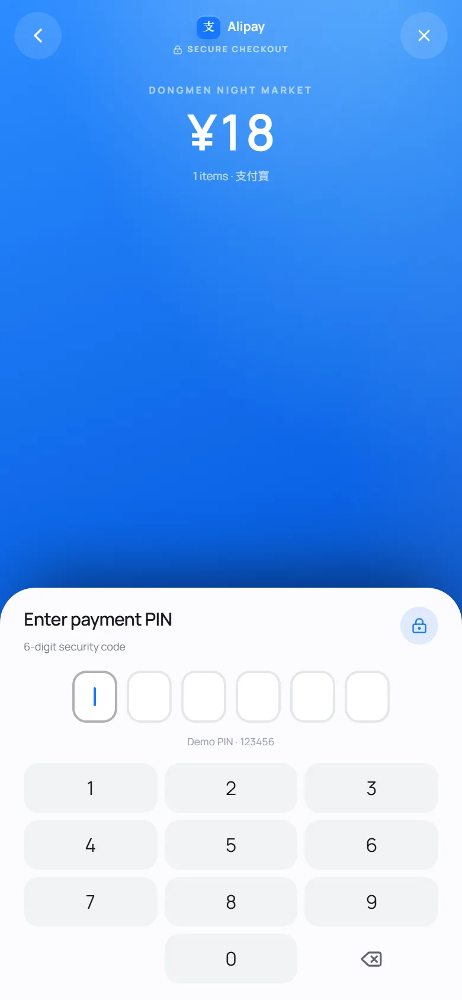
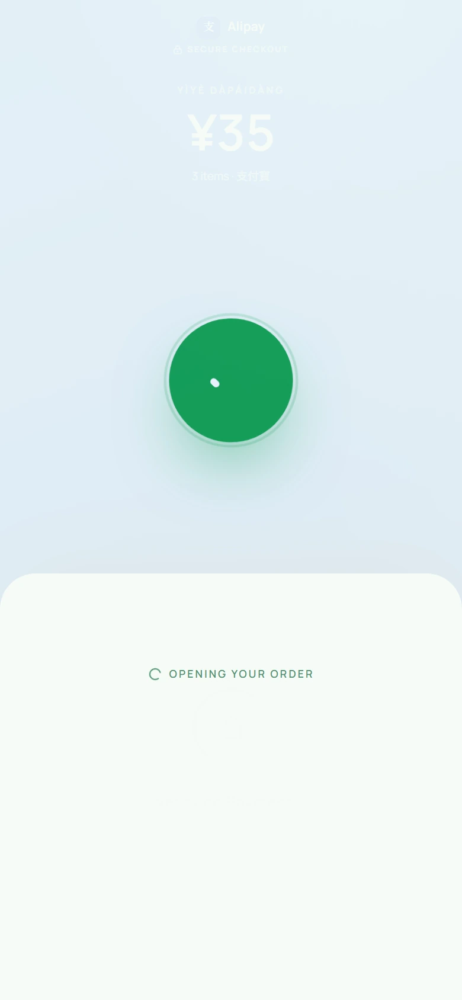

# Night Market POS · 夜市智慧點餐

A mobile-first smart POS demo for a Chinese night market, meant to be opened by scanning the QR code stuck to table 07. Built with Next.js (App Router), React 19, Tailwind CSS 4 and Framer Motion.

The phone shell is capped at **480px** and centred with `mx-auto`, so it still reads as a handset on a desktop monitor.

---

## Run locally

```bash
npm install
npm run dev
# http://localhost:3000
```

Production check:

```bash
npm run build
npm start
```

## Deploy to Vercel

1. Push the folder to a Git repository.
2. Import it in Vercel — the framework preset is detected as Next.js.
3. No environment variables are required for the demo.
4. Deploy. `public/food/*.webp` and `public/fonts/*.woff2` are served as static assets.

---

## What is in the box

| Area | Where |
| --- | --- |
| App shell, tab transitions, global chrome | `components/PosApp.tsx` |
| Active-tab header + language/theme switches | `components/Header.tsx` |
| Floating liquid-glass nav with sliding pill | `components/BottomNav.tsx` |
| Reusable food row | `components/MenuItemCard.tsx` |
| Quantity stepper | `components/QuantityControl.tsx` |
| Cart, checkout footer | `components/tabs/CartTab.tsx`, `components/CartFooter.tsx` |
| Mock wallet payment flow (sheet → PIN → verifying → success) | `components/payment/PaymentFlow.tsx` |
| Wallet brands, colours, secure-screen gradients | `lib/payment-methods.ts` |
| Completed orders | `components/tabs/OrdersTab.tsx` |
| Glossary (3 sticky-scroll sections) | `components/tabs/GlossaryTab.tsx` |
| Shimmer skeletons | `components/skeletons/*`, `components/ui/Skeleton.tsx` |
| App state / preferences / fetching | `lib/pos-store.tsx` |
| RLS-shaped data layer | `lib/data/api.ts` |
| Mock database + seeded rows | `lib/data/mock-db.ts` |
| Mock session (`user_id`, `session_id`) | `lib/data/session.ts` |
| Editable menu array | `lib/data/menu.ts` |
| Editable glossary arrays | `lib/data/glossary.ts` |
| Bilingual copy | `lib/i18n.ts` |
| Design tokens, glass, shimmer, grain | `app/globals.css` |
| Chinese subset `@font-face` rules | `app/fonts.css` |
| Supabase schema + RLS policies | `supabase/schema.sql` |

### Adding a menu item

Copy an object in `lib/data/menu.ts`, drop a square WebP into `public/food/`, point `image` at it. The card renders itself — no component changes.

### Editing the glossary

`lib/data/glossary.ts` exports `CHINESE_FOOD`, `COMMON_WORDS` and `COMMON_PHRASES`. Each entry is `{ id, hanzi, pinyin, en }`. The tab renders whatever is in the arrays.

---

## Mock wallet payment

*Pay now* (結帳) no longer checks out immediately. It opens a four-step, fully mocked wallet flow layered on top of the existing cart — no app structure, navigation or other tab was changed.

1. **Method sheet.** A Framer Motion bottom sheet slides up over a blurred scrim, showing the amount due and four Chinese wallets in their brand styling:

   | Wallet | Brand colour |
   | --- | --- |
   | Alipay · 支付寶 | Blue |
   | WeChat Pay · 微信支付 | Green |
   | UnionPay · 銀聯 | Red → blue → cyan |
   | JD Pay · 京東支付 | Red |

2. **Branded PIN screen.** Choosing a wallet dismisses the sheet and slides in a full-screen secure screen painted with that provider's gradient. It shows the charged total and a six-box PIN field over a 1–9 / 0 / delete numpad. Physical keyboards work too: digits, `Backspace`, and `Esc` to close.
3. **Validation.** Only the admin PIN **`123456`** is accepted (the demo PIN is printed subtly under the boxes). A wrong PIN shakes the boxes, clears them and lets the customer retry. The sixth correct digit hides the keypad at once and shows a spinner with *Verifying Payment...* / *處理中...* for **1.5 s**.
4. **Success → order.** A bold green check animation then holds for **1 s**, after which the overlay closes, the cart is cleared, the order is pushed into the Orders state and the app switches to the Orders tab automatically.

| Detail | Where |
| --- | --- |
| State machine, sheet, secure screen, PIN pad, verifying/success animation | `components/payment/PaymentFlow.tsx` |
| Wallet names, colours, gradients, marks | `lib/payment-methods.ts` |
| Order commit + cart clear + tab switch | `finalizePayment` in `lib/pos-store.tsx` |
| Payment copy (EN / 繁中) | `payment` block in `lib/i18n.ts` |

The overlay is mounted at `AppFrame` level (`components/PosApp.tsx`) rather than inside `CartFooter`, so clearing the cart cannot unmount the success screen mid-animation. Because the 1.5 s gateway wait is already animated, the store commits with `checkout(..., { paymentMethod, latency: 0 })`. The legacy `payNow` action is kept for compatibility but is no longer used by the footer, and the resulting `Order` records the wallet in `paymentMethod`.

| Method sheet | Alipay PIN | Success |
| --- | --- | --- |
|  |  |  |

The rest of the captured states (filled PIN, verifying, WeChat Pay, UnionPay, JD Pay) are in [`docs/payment/`](docs/payment).

---

## Loading & skeleton strategy

Every data-bound surface has a dedicated skeleton with an animated shimmer:

| Surface | Delay | Skeleton |
| --- | --- | --- |
| Menu | 850 ms | `MenuSkeleton` — hero card + 5 food rows |
| Cart | 1050 ms | `CartSkeleton` — line items + summary |
| Orders | 950 ms | `OrdersSkeleton` — 2 receipt cards |
| Glossary | 700 ms | `GlossarySkeleton` — 3 section shells |
| Wallet authorization | 1,500 ms | Provider-coloured spinner in the payment screen (mock gateway, not a skeleton) |

Menu and cart fetch on mount. Orders and glossary fetch lazily the first time their tab is opened. After payment, the checkout response already contains the refreshed, scoped order list, so Orders is complete the moment the tab appears — no second skeleton flash. The payment commit itself is instant (`latency: 0`) because the 1.5 s wait was already animated on screen.

All skeletons respect `prefers-reduced-motion` and expose `role="status"` + `aria-busy`.

---

## Row-Level Security, conceptually enforced

Rows in the mock database carry an explicit `userId`. The only function that lets cart or order rows leave `lib/data/api.ts` is:

```ts
function scopeByUser<T extends { userId: string }>(rows: T[], userId: string) {
  assertUser(userId); // no user_id → request blocked
  return rows.filter((row) => row.userId === userId);
}
```

Every call site passes `ACTIVE_SESSION.userId`:

```ts
fetchCart(ACTIVE_SESSION.userId);
fetchOrders(ACTIVE_SESSION.userId);
checkout(ACTIVE_SESSION.userId, ACTIVE_SESSION.sessionId, cartRef.current);
```

After the wallet screen completes, the store calls the same function with the chosen method and no artificial delay:

```ts
checkout(ACTIVE_SESSION.userId, ACTIVE_SESSION.sessionId, cartRef.current, {
  paymentMethod, // "Alipay" | "WeChat Pay" | "UnionPay" | "JD Pay"
  latency: 0,
});
```

The seed data includes a completed order (`#1048`) that belongs to a second user. It is never returned by a scoped query, which makes the filtering visible during development.

The Orders tab adds a second, UI-level filter (`order.userId === ACTIVE_SESSION.userId`) as defence in depth. When a real backend is connected, the database remains the trust boundary — the UI filter is not security.

### Moving to Supabase

`supabase/schema.sql` contains the production-shaped tables and policies:

- `menu_items` — public read for everyone.
- `cart_items` / `orders` / `order_items` — select/insert/update only when `auth.uid() = user_id`.
- Totals are recomputed server-side from the menu table (see `checkout` in `lib/data/api.ts` and the comment in the schema) so a tampered client cart cannot change the price.
- Orders and order items should be written through a server function/RPC using the service role; clients only ever read their own rows.

Replace the bodies of `lib/data/api.ts` with Supabase calls and the UI/store stay untouched.

---

## Design notes

- **Night-market palette.** Dark is the default: near-black plum canvas, ember orange accent (`#ff6b45`), jade for confirmations, warm gold for small details. Light mode flips to rice paper, ink and terracotta.
- **Typography.** Manrope for UI, Instrument Serif for display/italic English, locally hosted Noto Serif TC + Noto Sans TC subsets for Chinese. The pinyin lines use the serif italic.
- **Chinese font subsetting.** Only the 322 CJK glyphs actually used by the app are downloaded (≈101 KB sans + ≈136 KB serif) instead of multi-megabyte full families. After adding Chinese copy, run `node scripts/build-fonts.cjs`: it rescans the source, downloads the new subsets into `public/fonts/`, and rewrites `app/fonts.css`.
- **Liquid glass nav.** `backdrop-filter: blur(28px) saturate(170%)`, an inset highlight, and a Framer Motion `layoutId` pill that springs between tabs.
- **Menu row contract.** Square image spans exactly three text lines (72 px: 24 px name line + two 20 px description lines). Chinese name + pinyin on line 1, two-line description on lines 2–3. Price is baseline-aligned with the Chinese characters; the stepper is aligned with the end of the description.
- **Cart.** Thumbnail left, localised name with quantity directly beneath, line total right. The fixed glass footer sits above the nav.
- **Payment.** Native-app feel throughout: a spring-driven bottom sheet, a provider-gradient full screen that slides over it, six dot boxes with a blinking caret, a spring success check with a drawn tick and a pulsing halo. Everything is capped at 480px, and the numpad stays fully visible down to 320 × 568.
- **Orders.** Completed only. No images, bold `Order #XXXX`, clean item list, total left-aligned under the list.
- **Glossary.** Three independently scrollable sections. Food and words use char top-left, italic pinyin immediately below, English far right. Phrases stack: char, smaller italic pinyin, then English after a generous gap.
- **Accessibility.** Switch roles on both toggles, `aria-current` on nav, focus-visible rings, reduced-motion support, live regions for toasts and loading states.

---

## Image credits

Food photography is sourced from Wikimedia Commons and cropped to 560 × 560 WebP. Full attribution is in [`public/food/CREDITS.md`](public/food/CREDITS.md).
